

  

  
  

  
  
  
  

---

## About me

I'm a **Senior Mobile App Developer** with 5+ years of experience building scalable, high-performance apps with **Flutter** and **native Android (Kotlin / Java)**. I've shipped apps in healthcare, education, legal tech and e-commerce, including AI assistants for medical professionals, and I've led projects end to end as both developer and project manager.

<table>
  <tr>
    <td width="50%" valign="top">

**🧩 Core expertise**

- Flutter & Dart, iOS and Android
- Native Android with Kotlin and Java
- Mobile architecture and scalable systems
- Performance, stability and clean code
- Firebase, REST APIs and third-party SDKs
- AI-powered mobile features
- App Store and Google Play releases

</td>
    <td width="50%" valign="top">

**🏆 Highlights**

- Top Rated Plus freelancer on Upwork, 100% Job Success
- 30+ mobile projects delivered
- Large-scale production apps: crash, ANR and performance work
- Long-term collaborations with international teams
- Comfortable leading projects and coordinating UI/UX, web and backend teams

</td>
  </tr>
</table>

## 🧰 Tech stack

  

## 📱 Shipped apps

Production apps I built or led, live in the stores and used by real people.

<!-- Hammel -->
<table>
  <tr>
    <td width="52%" valign="top">
      
      <h3>&nbsp;Hammel · File Manager</h3>
      &nbsp;<b>Senior Android Developer</b> · Productivity
        
      
      
      
      
A large-scale Android file manager for organizing, importing and capturing files, with built-in AI tools.

      <ul>
        <li>Shipped major features and AI tools that grew the user base</li>
        <li>Monitored releases and fixed production crashes, ANRs and non-fatal issues</li>
        <li>Improved performance and stability at multi-million-user scale</li>
        <li>Worked with mobile, backend, UI/UX and QA teams across the full release flow</li>
      </ul>
      
      
      
      
        
      
    </td>
    <td width="48%" align="center" valign="middle">
      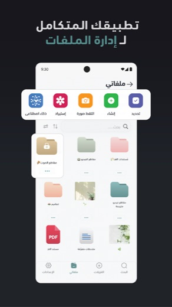
      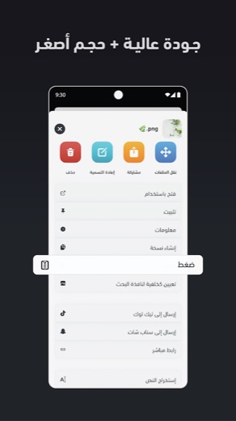
      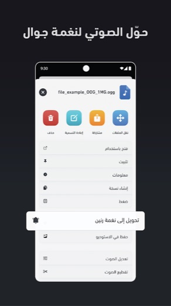
    </td>
  </tr>
</table>

<!-- MAIA -->
<table>
  <tr>
    <td width="48%" align="center" valign="middle">
      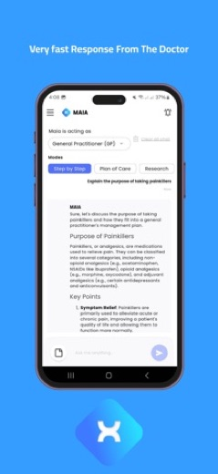
      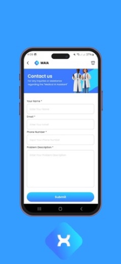
      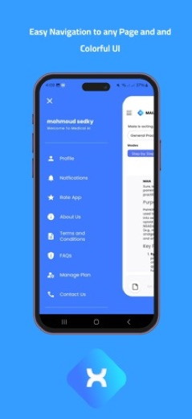
    </td>
    <td width="52%" valign="top">
      
      <h3>&nbsp;MAIA · Medical AI Assistant</h3>
      &nbsp;<b>Mobile Developer & Project Manager</b> · Medical
        
      
An AI medical assistant that gives physicians, nurses and medical students fast, detailed and well-referenced answers.

      <ul>
        <li>Built the Flutter app for iOS and Android from the ground up</li>
        <li>Managed the project and coordinated the UI/UX designer and the React + Nest.js web team</li>
        <li>Delivered the AI chat, specialty selection and answer modes such as step-by-step, plan of care and research</li>
      </ul>
      
      
      
      
        
      
    </td>
  </tr>
</table>

<!-- CAIA -->
<table>
  <tr>
    <td width="52%" valign="top">
      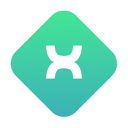
      <h3>&nbsp;CAIA · Medical Coding AI</h3>
      &nbsp;<b>Mobile Developer & Project Manager</b> · Medical
        
      
An AI assistant for doctors, nurses and medical coders that simplifies clinical workflows, medical coding and documentation, with AI chat and medical file uploads.

      <ul>
        <li>Designed the app architecture and planned delivery</li>
        <li>Built the Flutter app with AI chat and document upload flows</li>
        <li>Led coordination between design, web and mobile</li>
      </ul>
      
      
      
      
        
      
    </td>
    <td width="48%" align="center" valign="middle">
      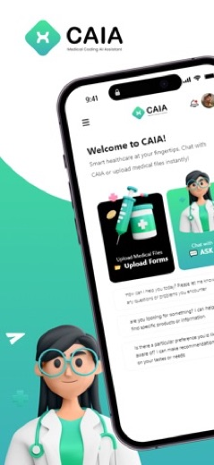
      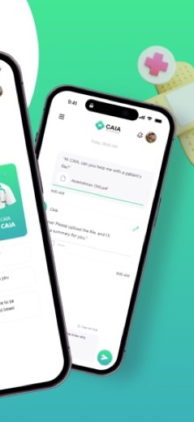
      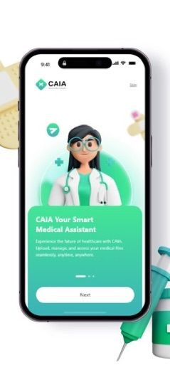
    </td>
  </tr>
</table>

<!-- MRCS -->
<table>
  <tr>
    <td width="48%" align="center" valign="middle">
      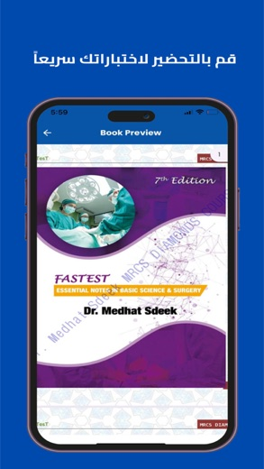
      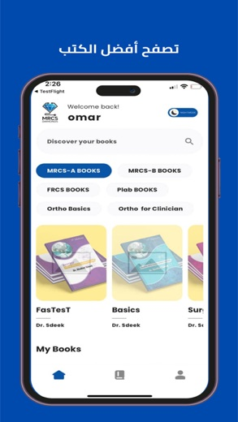
      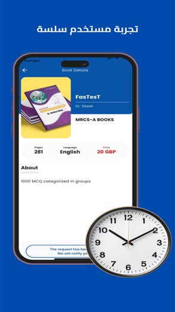
    </td>
    <td width="52%" valign="top">
      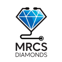
      <h3>&nbsp;MRCS Diamonds</h3>
      &nbsp;<b>Mobile Developer</b> · Education
        
      
A courses and books platform for surgeons preparing for the MRCS exam, with an in-app book reader.

      <ul>
        <li>Built the full Flutter app with Firebase as the backend</li>
        <li>Delivered course content, book previews and the reading experience</li>
        <li>Worked with a UI/UX designer from Figma to release</li>
      </ul>
      
      
      
        
      
    </td>
  </tr>
</table>

<!-- SALAMA + Zamen -->
<table>
  <tr>
    <td width="50%" valign="top" align="center">
      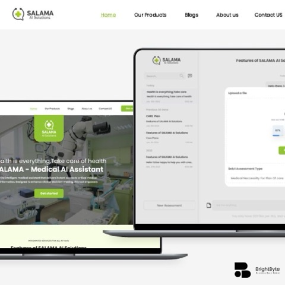
      <h3>SALAMA · Medical AI Platform</h3>
      <b>Project Manager</b> · Web
      
A diagnosis and analytics platform for medical professionals. I planned the technical architecture and coordinated the UI/UX and web teams through delivery.

      
      
        
      
    </td>
    <td width="50%" valign="top" align="center">
      
      <h3>Zamen · Legal Management</h3>
      <b>Mobile Developer</b> · Legal tech
      
A law management app for companies in Saudi Arabia, built in Flutter with the UI/UX design team and an Express backend team.

      
      
      
    </td>
  </tr>
</table>

## 💼 Experience

| Role | Company |
| --- | --- |
| Mid-Senior Mobile App Developer (Flutter & Android) | Gyoom |
| Software Engineer & Research | University of Louisville |
| Junior Flutter Developer | Elmeyasoft |
| Mobile App Development Trainee | YAT Training Center |

🎓 **B.Sc. Communication and Computer Engineering**, Mansoura University

🌍 Arabic (native) · English (fluent) · German (basic)

## 🧪 Open-source samples

| Project | Stack | Description |
| --- | --- | --- |
| [FakeStore-Android](https://github.com/omarmeciry21/FakeStore-Android) | Kotlin · MVVM · Retrofit · Room | E-commerce app with categories, search, favourites and cart |
| [android_news_app](https://github.com/omarmeciry21/android_news_app) | Kotlin · MVVM · Retrofit · Room | News app with breaking news, search and saved articles |
| [e_commerce_test](https://github.com/omarmeciry21/e_commerce_test) | Flutter · Dart | Cross-platform e-commerce app with a demo video |
| [SpringBoot-Books-Demo-App](https://github.com/omarmeciry21/SpringBoot-Books-Demo-App) | Java · Spring Boot · JDBC | Books and authors data layer with unit and integration tests |

## 📊 GitHub activity

  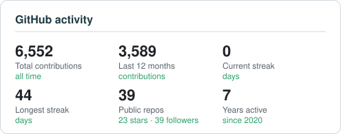
  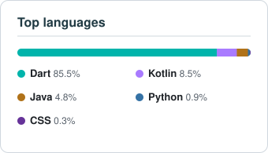

  <picture>
    <source media="(prefers-color-scheme: dark)" srcset="https://raw.githubusercontent.com/omarmeciry21/omarmeciry21/output/github-snake-dark.svg" />
    
  </picture>

Cards and snake are generated daily by a GitHub Action in this repo.

## 🤝 Let's work together

Need a mobile app built, scaled or stabilized? I'm available for freelance and long-term work.

  
  

